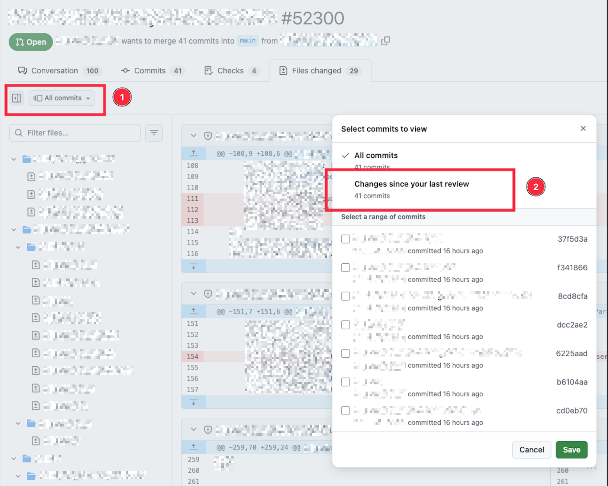
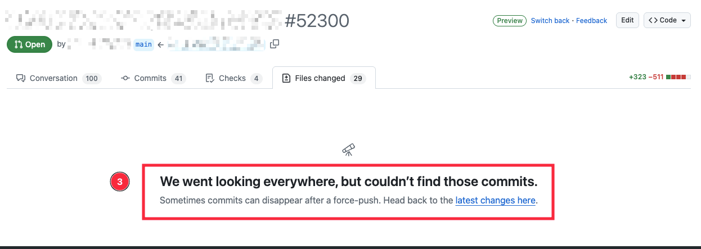

# GitHub

## Don't rebase and force push after code review

❌ DON'T rebase or force push once a review has started.

✅ DO: push new fixup commits instead of amending and force pushing.

GitHub's "Changes since your last review" feature lets reviewers see only what
changed since they last looked — saving them from re-reading the whole PR. A
rebase destroys this: the old commits disappear and the diff breaks.

In monorepos where PRs are squash-merged, force pushing is also pointless — the
history gets thrown away on merge anyway. It only makes reviewers' lives harder.





See
[Changes since last review — daisy.wtf](https://daisy.wtf/writing/github-changes-since-last-review/)
for a deeper look at why this breaks and how to work around it.

## Always create PRs as drafts

✅ DO: `gh pr create --draft`

Mark PRs as draft until they're ready for review. It signals intent, prevents
accidental review requests, and lets you keep pushing without notifying
reviewers.

## Write concise PR descriptions

Follow the repo's `.github/PULL_REQUEST_TEMPLATE.md` if one exists. Otherwise
use this structure:

```markdown
## What

1. <one short line per change>

## Why

1. <one short line — paired with the What above>

## Testing

- <category only, e.g. "Unit tests", "Manual QA">
```

- Each **What** item pairs with the same-numbered **Why** item.
- **Why** matters more than **What** — focus there.
- 3 pairs is ideal, 5 is the hard max.
- No file paths, function names, or implementation details.
- If a bullet runs to a second sentence, delete it.
